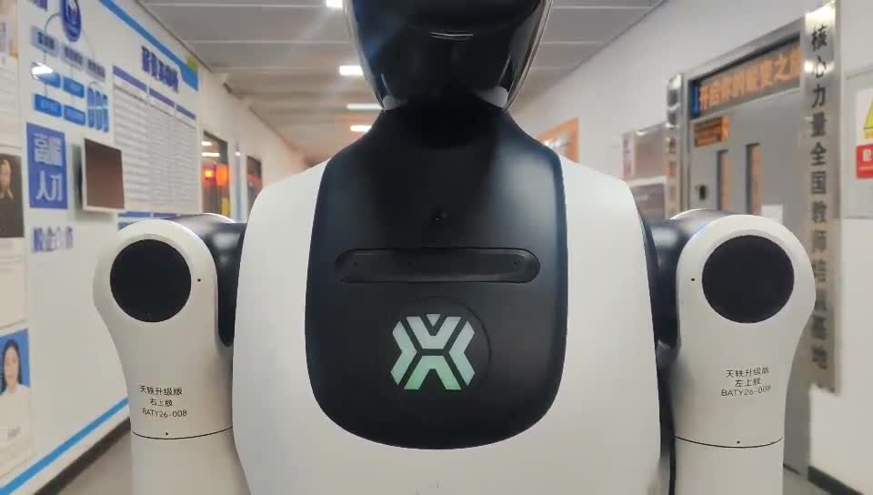
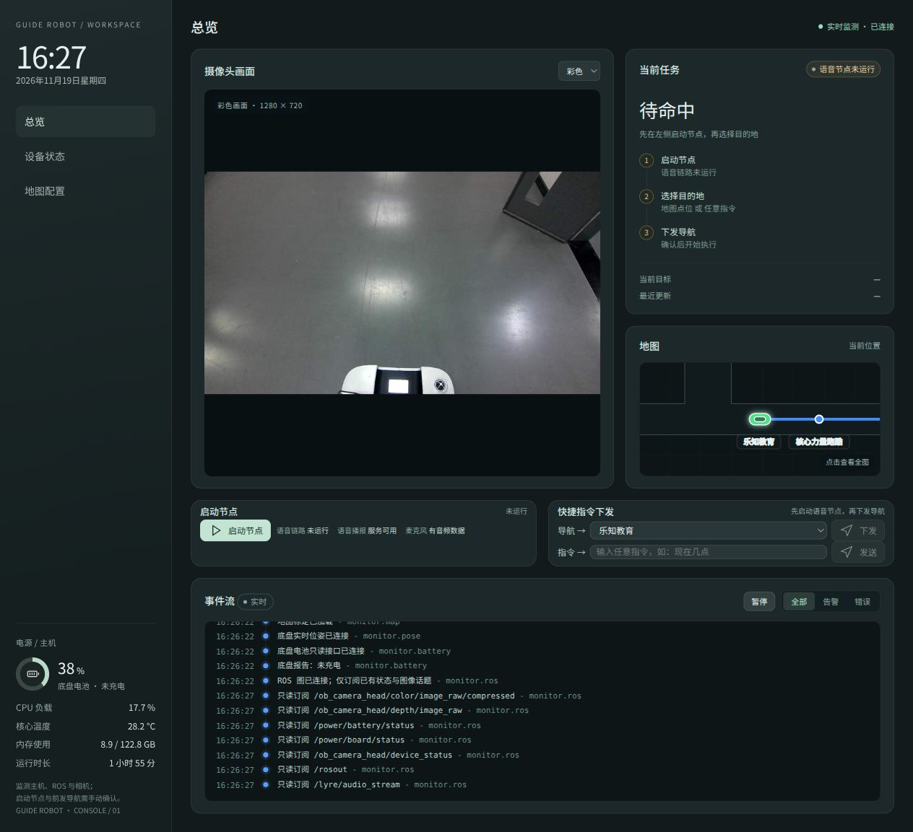

# 访客带路机器人 · Visitor Wayfinding Robot

面向展厅与教育空间的语音带路项目。访客说出目的地，机器人识别地点、导航送达、播报到达信息；送达后或叫停后无人继续交互，会按配置自动回到待命点。

本项目负责“带人去某个地方”；固定路线参观与逐站讲解由 [guided_tour_robot](https://github.com/cisyam555/guided_tour_robot) 实现。

## 实机演示

点击封面打开演示视频。视频记录于 2026 年 11 月 19 日，时长约 3 分 42 秒。

[](https://github.com/cisyam555/visitor_wayfinding_robot/raw/refs/heads/main/docs/videos/wayfinding-demo.mp4)

[观看 / 下载演示视频](https://github.com/cisyam555/visitor_wayfinding_robot/raw/refs/heads/main/docs/videos/wayfinding-demo.mp4) · [查看仓库内视频文件](docs/videos/wayfinding-demo.mp4)

视频原文件保存在仓库中；GitHub README 展示封面，点击后由浏览器打开或下载 MP4。

## 网页预览

机器人连接状态下的实际网页截图，展示头部相机画面、电池与主机数据。截图是当时状态的记录，不代表当前导航状态。



网页提供设备监测、相机画面、运行示意图与指令入口，详见 [Web 工作台说明](web/README.md)。

## 功能与交互流程

```text
待命 → 有人靠近 → 问候 → 理解目的地 → 导航 → 到点转身展示 → 交互等待
                            ↑          ↓                         ↓
                         确认/改道   叫停或被叫住             结束语/等待超时
                                       ↓                         ↓
                                  暂停、继续或回程 ←──────── 自动回待命点
```

| 场景 | 行为 |
| --- | --- |
| “带我去创想谷” | 匹配地点后直接导航 |
| 只说“创想谷” | 询问是否需要带路，确认后出发 |
| “我想练跆拳道” | 模型推断地点，校验为已配置点位后询问确认 |
| 导航中说“停一下” | 请求取消当前导航，进入暂停 |
| 导航中说新目的地 | 取消当前任务，改去新目标 |
| 被叫住或询问 | 按本地意图规则暂停并处理，普通无关输入可能被忽略 |
| “继续” | 恢复暂停的目标 |
| “回去吧 / 没事了” | 返回待命点 |
| 送达或暂停后无人说话 | 默认 35 秒后自动回程，可分别配置 |
| 前方被挡 | 保留目标、停车让行；道路清空后续行 |

到点按配置左转或右转展示，播报后默认再停留 2 秒并转回；从反方向进入点位时调整转向方向。回到待命点后尝试恢复离开时的朝向。

## 语音交互改进

- **减少指令被回声吞掉**：识别文本混入机器人刚说过的话时，先尝试剥离播报片段，再处理剩余用户指令；纯回声仍会被过滤。
- **短句衔接**：对“带我去”与随后识别的地点进行短时间拼接，减少断句造成的目的地丢失。
- **模型回退**：配置的识别模型加载失败时，尝试使用 `small`；两者都加载失败则停用本地麦克风识别并记录错误。
- **识别参数可调**：启动时可配置模型、beam、VAD 能量阈值和断句静音时间，在反应速度、识别效果与现场噪声间调整。

这些处理改善交互容错，实际识别效果仍取决于距离、噪声、麦克风和模型。

## 技术实现

- **ROS 2 节点**：`learn3_d/tour_chat` 编排语音、意图、导航和播报。
- **语音入口**：本地 faster-whisper、平台 ASR、`/tour/chat` 文本话题；本地语音无需唤醒词。
- **地点理解**：`places.yaml` 别名匹配优先；模糊意图使用 OpenAI 兼容的 Qwen 接口，结果须通过地点校验。
- **底盘控制**：`robot_controller` SDK 调用底盘 REST 服务，下发异步导航任务并轮询结果；并非通过 `/cmd_vel` 直接控制速度。
- **播报**：复用平台 TTS，串行播报并临时切换项目音色；关键指令可打断播报，普通闲聊在播报期间可能被忽略。
- **冲突防护**：文件锁拒绝重复启动本项目；启动时提示其他可能抢占底盘的导航进程。

语音识别、网络请求及底盘取消都有延迟，代码中的叫停逻辑不等同于经过认证的硬件急停。

## 环境与构建

运行环境：机器人上的 ROS 2 Jazzy、`/home/nvidia/xos` 平台工作空间、底盘 SDK，以及 `numpy`、`PyYAML`、`faster-whisper`。网页另需 `psutil`、OpenCV。地图及 POI 保存在底盘中，仓库不包含完整机器人平台。

```bash
cd /home/nvidia/guide_robot/learn/visitor_wayfinding_robot
source /opt/ros/jazzy/setup.bash
source /home/nvidia/xos/setup.bash
colcon build --packages-select learn3_d --symlink-install
source install/setup.bash
ros2 launch learn3_d tour.launch.py
```

启动后默认进入待命交互。请只运行一个控制底盘的项目。

## 常用配置

| 参数 | 默认值 | 用途 |
| --- | --- | --- |
| `map` | `消防` | 底盘地图名 |
| `reloc_poi` | `乐知教育` | 待命及重定位参考点 |
| `nav_direct` | `true` | 直接前往目标；false 按主线逐段走 |
| `track` | 空 | 空表示点对点；指定名称才使用录制轨道 |
| `await_timeout` | `35.0` | 送达后自动回程等待秒数，0 关闭 |
| `pause_timeout` | `35.0` | 被叫停后自动回程等待秒数，0 关闭 |
| `enable_voice` | `true` | 是否播报 |
| `enable_nav` | `true` | 是否启用导航 |
| `enable_presence` | `true` | 靠近检测与问候 |
| `qwen_base_url` / `qwen_model` | 见 launch | 模型服务与模型名称 |
| `asr_model` | `small` | 本地识别模型，需预先准备模型文件或允许下载 |
| `asr_beam_size` | `3` | 识别搜索宽度，增大通常也会增加耗时 |
| `vad_threshold` | `300.0` | 语音能量阈值，嘈杂环境可调大 |
| `vad_silence_s` | `0.4` | 判定一句话结束的静音秒数 |

```bash
# 指定地图及待命点
ros2 launch learn3_d tour.launch.py map:=消防 reloc_poi:=乐知教育

# 关闭两种超时自动回程
ros2 launch learn3_d tour.launch.py await_timeout:=0 pause_timeout:=0

# 只测试对话，不启用导航
ros2 launch learn3_d tour.launch.py enable_nav:=false

# 调整本地语音识别与断句
ros2 launch learn3_d tour.launch.py asr_model:=small asr_beam_size:=3 vad_threshold:=300.0 vad_silence_s:=0.4
```

地点与别名修改 `src/learn3_d/config/places.yaml`，点位名必须与底盘一致。默认地点为乐知教育、核心力量跑酷、创想谷、厕所和跆拳道馆。新增地点还需核对主线、支线和到点转向配置。

更多 ROS 参数在 `tour_chat.py` 中声明，可使用 `ros2 run learn3_d tour_chat --ros-args -p 参数:=值` 覆盖。修改安装配置或入口后重新构建并重启节点。

## 网页启动

```bash
cd /home/nvidia/guide_robot/learn/visitor_wayfinding_robot
bash web/start_monitor.sh --port 8765
```

浏览器访问 `http://<机器人IP>:8765/`。监测服务独立运行；启动节点、停止本页启动的节点、导航和文本指令均由页面确认后提交。运行示意图用于展示沿线位置，不是精确地图。

## 代码入口

| 文件 | 职责 |
| --- | --- |
| `src/learn3_d/learn3_d/tour_chat.py` | 状态机、意图分发、播报与自动回程 |
| `src/learn3_d/learn3_d/nav_core.py` | 任务下发与取消、定位恢复、到点校验、转身 |
| `src/learn3_d/learn3_d/mic_asr.py` | 音频、VAD 与本地识别 |
| `src/learn3_d/learn3_d/front_guard.py` | 前向深度检测 |
| `src/learn3_d/config/places.yaml` | 地点、别名与主线 |
| `src/learn3_d/launch/tour.launch.py` | 启动参数 |
| `web/` | 独立工作台及其测试 |

## 排障与运行边界

- 无语音输入：检查麦克风话题、ASR 和平台服务；日志按 `~/guide_logs/tour_chat_visitor_YYYYMMDD.log` 单独保存。
- 不导航或导航失败：核对地图、POI、定位置信度、底盘故障和是否存在其他导航进程。
- 播报失败：检查平台 TTS 与网络；平台“音频生成失败”提示音会被过滤，避免成为用户输入。
- 模型不可达：使用降级话术；不将未校验的模型输出直接当成导航目标。
- 深度检测仅覆盖相机可见区域；定位恢复、转身与取消效果需要在现场验证。
- 网页面向可信局域网；显示在线或电量正常并不代表已具备出发条件。

网页离线测试：`cd web && python3 -m unittest test_monitor -v`。硬件导航和语音效果需在机器人上另行验证。
