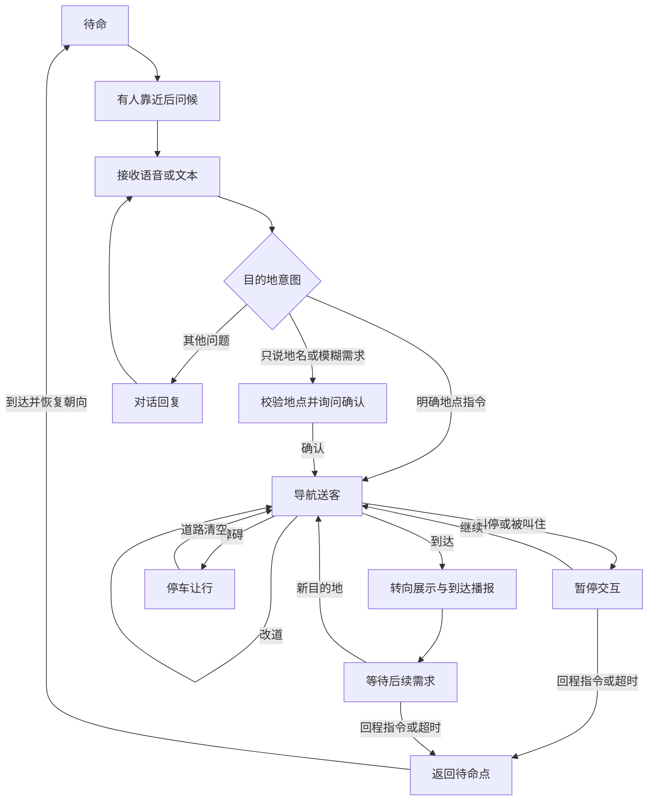
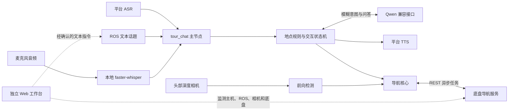
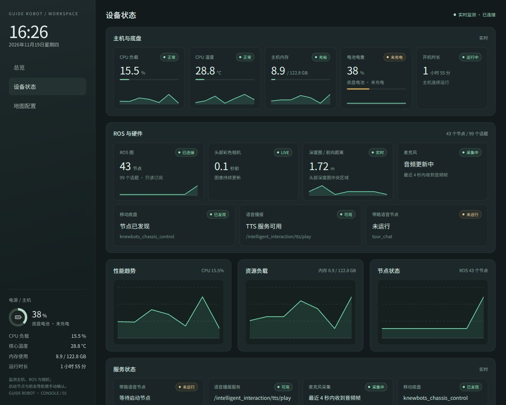
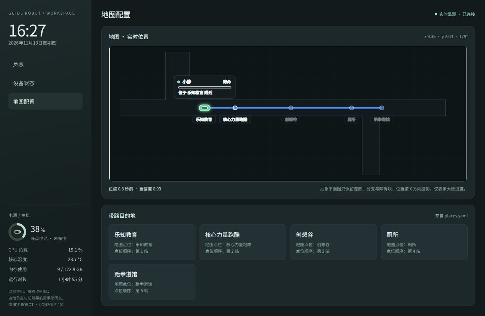

<div align="center">

# 小静 · 访客带路机器人

**Visitor Wayfinding Robot**

从一句“带我去”，到送达目的地，再自动回到待命点。


[](src/learn3_d/LICENSE)

[实机演示](#实机演示) · [功能介绍](#功能介绍) · [快速开始](#快速开始) · [网页工作台](#网页工作台) · [代码入口](#代码入口)

</div>

## 项目介绍

小静是面向展厅、教育空间等室内场景的访客带路机器人应用。访客通过自然语言提出目的地，机器人完成地点理解、确认、导航、到达交互和自动回程，形成一次完整的带路服务。

项目基于 **ROS 2 Jazzy**，集成本地语音识别、平台 TTS、Qwen 对话接口与底盘 REST 导航，并提供独立的 Web 工作台。地点指令优先由本地规则处理，模糊表达再交给模型推断，模型返回的目的地必须通过已知点位校验。

本仓库侧重按访客需求前往指定地点。按固定路线逐站参观、讲解的项目见 [guided_tour_robot](https://github.com/cisyam555/guided_tour_robot)。

> 仓库包含应用代码与工作台。运行依赖机器人已有的底盘 SDK、地图、相机、麦克风及平台语音服务；克隆代码到普通电脑后不能直接控制机器人。

## 实机演示

2026 年 11 月 19 日实机视频，时长约 **3 分 42 秒**。点击下方播放器即可在 GitHub 内观看。

https://github.com/user-attachments/assets/1db069cb-c379-418b-94f1-81ea591590b7

在线播放版保留完整时长和声音。[下载原始 MP4](https://github.com/cisyam555/visitor_wayfinding_robot/raw/refs/heads/main/docs/videos/wayfinding-demo.mp4)。播放器无法加载时可下载后观看。

## 功能介绍

- **自然语言带路**：明确目的地直接导航，只说地点先确认，间接需求通过模型推断并校验。
- **连续语音交互**：本地 faster-whisper 无需唤醒词；同时支持平台 ASR 和 ROS 文本输入。
- **途中交互**：识别叫停、改道、回程及叫住提问等意图，取消或暂停当前任务后处理。
- **到点展示**：按地点配置转向、播报、短暂停留并转回；回程尝试恢复待命朝向。
- **自动回程**：送达后或被叫停后，默认 35 秒无人继续交互则返回待命点；明确回程指令无需等超时。
- **前向障碍处理**：结合深度相机与底盘导航，遇阻停车让行，保留目标并在道路清空后续行。
- **语音容错**：过滤播报回声、剥离混入指令的播报片段、衔接被断句的目的地表达，支持识别模型加载失败回退。
- **运行监测**：查看相机、主机资源、电池、任务日志与沿线示意位置，支持经确认的节点和指令操作。

### 交互示例

| 你说 | 机器人处理 |
| --- | --- |
| 带我去创想谷 | 匹配点位后出发 |
| 创想谷 | 先询问是否需要带路 |
| 我想练跆拳道 | 推断到已配置地点，再询问确认 |
| 停一下 | 请求取消导航并进入暂停 |
| 改去厕所 | 取消原任务，切换目标 |
| 继续 | 恢复暂停的目的地 |
| 回去吧 / 没事了 | 按当前交互状态处理回程 |

关键指令可打断播报；普通闲聊在播报或导航期间可能被忽略。语音叫停涉及识别和底盘通信延迟，不替代硬件急停。

## 服务流程



默认到点转向角度为 90°，播报结束后再停留 2 秒并转回。送达等待和暂停等待分别计时；回程失败时需要根据日志处理，不保证所有异常都能自动恢复。

## 技术架构



导航由底盘服务规划并执行，应用负责目标下发、结果轮询、取消与异常处理。本项目不直接通过 `/cmd_vel` 实现带路。模型不直接生成底盘运动指令。

## 快速开始

### 1. 准备运行环境

- ROS 2 Jazzy 与 `colcon`。
- 机器人平台环境：默认 `/home/nvidia/xos/setup.bash`，提供自定义语音消息和服务。
- 底盘 SDK：默认 `/home/nvidia/robot_controller/src`，可通过 `ROBOT_CONTROLLER_SRC` 环境变量指定。
- Python 依赖：`faster-whisper`、`numpy`、`PyYAML`；工作台另需 `psutil`、OpenCV。
- 机器人已有地图、POI、头部深度相机及音频话题；底盘 REST 默认地址为 `192.168.11.10:9090`。
- 本地识别模型文件，以及用于模糊意图与问答的可达模型服务。

`small` 为默认识别模型，使用 CPU / int8。配置其他模型加载失败时会尝试回退到 `small`；首次使用需准备缓存或保证模型下载可用。

### 2. 获取并构建

首次部署时，在机器人上执行：

```bash
git clone https://github.com/cisyam555/visitor_wayfinding_robot.git
cd visitor_wayfinding_robot
source /opt/ros/jazzy/setup.bash
source /home/nvidia/xos/setup.bash
colcon build --packages-select learn3_d --symlink-install
source install/setup.bash
```

现有机器人部署目录为 `/home/nvidia/guide_robot/learn/visitor_wayfinding_robot`。更新已有部署时，在该目录更新代码并构建即可，无需重复克隆。

### 3. 启动带路节点

```bash
ros2 launch learn3_d tour.launch.py
```

默认使用 `消防` 地图、`乐知教育` 待命点，启动后等待访客交互。现场点位名称必须与配置一致。启动前确认没有其他导航项目同时控制底盘；本项目会拒绝重复实例，并提示已发现的其他导航进程。

### 4. 验证交互

先在可控场地测试“你好”，再测试“带我去创想谷”“停一下”“继续”和“回去吧”。没有麦克风输入时，也可在已加载同样 ROS 环境的终端发送文本：

```bash
# 对话输入，不指定运动目的地
ros2 topic pub --once /tour/chat std_msgs/msg/String "{data: '你好'}"
```

确认识别、播报、地图与停车行为后，再测试完整送客和回程流程。

## 地点与参数配置

### 地点配置

编辑 [places.yaml](src/learn3_d/config/places.yaml)。默认提供乐知教育、核心力量跑酷、创想谷、厕所和跆拳道馆。

```yaml
standby: 乐知教育
aliases:
  乐知教育: 乐知教育
  创想谷: 创想谷
  厕所: 厕所
  卫生间: 厕所
main_line:
  - 乐知教育
  - 创想谷
  - 厕所
```

上方为字段示例，实际配置还包含其他点位与中转点。别名映射到的 POI 必须存在于底盘地图中；主线按物理顺序填写。点位改名时同步检查节点中的到点转向配置。

### 常用启动参数

| 参数 | 默认值 | 用途 |
| --- | --- | --- |
| `map` | `消防` | 底盘地图 |
| `reloc_poi` | `乐知教育` | 待命与重定位参考点 |
| `nav_direct` | `true` | 直接导航；false 按主线逐段走 |
| `track` | 空 | 空表示点对点，指定名称才使用录制轨道 |
| `await_timeout` | `35.0` | 送达后的自动回程等待秒数 |
| `pause_timeout` | `35.0` | 叫停后的自动回程等待秒数 |
| `enable_nav` | `true` | 是否连接底盘导航 |
| `enable_voice` | `true` | 是否启用播报 |
| `enable_presence` | `true` | 是否靠近问候 |
| `asr_model` | `small` | 本地识别模型 |
| `asr_beam_size` | `3` | 识别搜索宽度 |
| `vad_threshold` | `300.0` | 语音能量阈值 |
| `vad_silence_s` | `0.4` | 断句静音时间，秒 |

```bash
# 指定地图和待命点
ros2 launch learn3_d tour.launch.py map:=消防 reloc_poi:=乐知教育

# 关闭送达及叫停后的超时自动回程
ros2 launch learn3_d tour.launch.py await_timeout:=0 pause_timeout:=0

# 只测试对话，不启用导航
ros2 launch learn3_d tour.launch.py enable_nav:=false

# 调整识别与断句参数
ros2 launch learn3_d tour.launch.py \
  asr_model:=small asr_beam_size:=3 \
  vad_threshold:=300.0 vad_silence_s:=0.4
```

模型地址、模型名和请求超时通过 `qwen_base_url`、`qwen_model`、`qwen_timeout` 配置。完整 launch 参数见 [tour.launch.py](src/learn3_d/launch/tour.launch.py)；其他节点参数见 [tour_chat.py](src/learn3_d/learn3_d/tour_chat.py)。修改配置后重新构建并重启对应节点。

## 网页工作台

工作台将相机、任务、硬件状态与地点信息集中在三个页面中。以下截图均于 **2026 年 11 月 19 日连接机器人后实机采集**；截图时带路语音节点未启动，展示的是监测状态。

### 总览：相机画面与当前任务


- **相机画面**：查看头部相机的实时彩色图像，观察机器人前方环境。
- **当前任务**：查看节点是否运行、当前目标及任务更新时间；右侧小地图提供当前位置入口。
- **操作入口**：启动带路节点、选择目的地或输入文本指令；节点未启动时，导航和文本发送按钮不可用。
- **事件流**：集中查看监测连接、话题订阅与运行日志，可按告警、错误筛选。

### 设备状态：主机资源与 ROS 硬件



- **主机与底盘**：展示 CPU 负载、温度、内存、电池电量与开机时长。
- **ROS 与硬件**：展示节点及话题数量、相机更新情况、深度图中央区域距离和麦克风音频接收状态。
- **服务状态**：区分移动底盘节点已发现、TTS 服务可用、带路语音节点是否运行，方便启动前排查。
- **变化趋势**：通过资源曲线观察短时间内的负载变化。

截图中的“服务可用”“节点已发现”表示监测到了对应接口或节点，具体带路任务状态以总览中的任务信息为准。

### 地图配置：目的地与沿线位置



- **位置监测**：展示底盘上报的位姿、朝向、更新时间与定位置信度。
- **沿线示意**：展示机器人与乐知教育、核心力量跑酷、创想谷、厕所、跆拳道馆等地点的位置关系。
- **目的地配置**：读取 `places.yaml`，列出地点名称、底盘地图点位与配置顺序，便于核对目的地。

该页面展示抽象走廊示意，机器人位置按 X 方向投影，用于观察大致进度；它不是精确导航地图，也不是底盘实际行驶轨迹。目的地顺序用于配置展示，带路任务仍按用户选择的目标执行。

### 打开实时工作台

**[打开实时工作台（机器人局域网）](http://192.168.21.19:8765/)** · [工作台启动与使用文档](web/README.md)

在机器人项目目录另开终端运行：

```bash
bash web/start_monitor.sh --port 8765
```

电脑与机器人须处于可互通的局域网，浏览器访问 `http://<机器人IP>:8765/`；IP 变化后请更换地址。GitHub 首页提供文档、截图与视频，实时数据由机器人上的监测服务提供。

监测进程与导航节点独立。只打开监测页面不会自动启动带路任务；启动节点、停止本页启动的节点、下发导航与发送文本指令均需手动操作并确认。

## 代码入口

建议从启动文件开始，依次阅读主节点、导航核心和语音模块。文件名均可点击。

- [tour.launch.py](src/learn3_d/launch/tour.launch.py)：启动参数与节点配置。
- [tour_chat.py](src/learn3_d/learn3_d/tour_chat.py)：意图处理、交互状态、播报和自动回程。
- [nav_core.py](src/learn3_d/learn3_d/nav_core.py)：导航任务、取消、定位恢复、到点与转向。
- [nav_route.py](src/learn3_d/learn3_d/nav_route.py)：路线导航入口与复用封装。
- [mic_asr.py](src/learn3_d/learn3_d/mic_asr.py)：音频接入、VAD 与本地语音识别。
- [front_guard.py](src/learn3_d/learn3_d/front_guard.py)：前向深度检测。
- [places.py](src/learn3_d/learn3_d/places.py)：地点、别名与路线解析。
- [qwen.py](src/learn3_d/learn3_d/qwen.py)：模型接口客户端。
- [places.yaml](src/learn3_d/config/places.yaml)：现场地点配置。
- [web 目录](web/)：工作台前后端及离线测试。

## 测试与排障

### 离线检查

在具备工作台 Python 依赖及 Node.js 的开发环境中执行：

```bash
cd web
python3 -m unittest test_monitor -v
node --check live.js
```

现有工作台测试覆盖操作确认、地点白名单、节点运行前置条件、文件访问限制、过期图像和状态数据处理。它们不启动机器人，不能替代实机导航、语音及停车测试。

### 常见问题

- **网页打不开**：确认监测服务运行、IP 和端口正确、网络互通。打开 GitHub 的 `web/README.md` 看到的是使用文档。
- **语音无反应**：检查音频话题、ASR、模型加载及平台服务；降低 VAD 阈值会增加灵敏度，也可能引入噪声。
- **能对话但不走**：检查 `enable_nav`、地点匹配、底盘健康、定位状态及其他导航进程。
- **播报无声音**：检查 TTS 服务和网络；平台“音频生成失败”提示音会被过滤，避免变成用户指令。
- **模型不可达**：检查模型地址与超时。模型请求失败使用降级回复，不将未校验的地点用于导航。
- **回程失败**：查看定位、障碍与底盘任务状态；必要时由现场人员处理。

对话与任务日志默认保存为 `~/guide_logs/tour_chat_visitor_YYYYMMDD.log`。

## 运行边界

- 深度相机仅覆盖可见区域；软件叫停、防撞和定位恢复都需要现场验证。
- 自动回程依赖可用地图、定位与底盘，不等于异常情况下保证返回。
- Web 工作台面向可信局域网；设备在线和电量正常不代表已经满足出发条件。
- 本项目复用平台全局 TTS 音色，多个语音或导航项目并行运行可能造成冲突。

## 参与改进

欢迎通过 [Issues](https://github.com/cisyam555/visitor_wayfinding_robot/issues) 反馈问题，附上复现步骤、相关参数和已脱敏日志。提交改动时使用 `feat:`、`fix:`、`docs:` 等清晰的提交类型；涉及导航、识别或取消逻辑的改动，请说明实机验证情况。

## 许可证

项目软件包采用 [Apache License 2.0](src/learn3_d/LICENSE)。外部底盘 SDK、机器人平台、模型及其他依赖遵循各自的许可证与使用条件。
